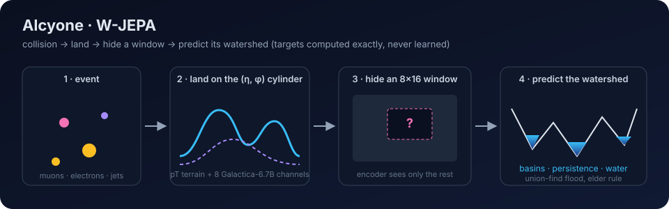

# Alcyone

**A W-JEPA: a joint-embedding predictive architecture whose prediction target is the watershed of a hidden region, computed exactly from proved lemmas.**

[](LICENSE)
[](https://huggingface.co/teerthsharma/Alcyone-W)

Teerth Sharma · [teerth.dev](https://teerth.dev) · [teerth.blog](https://teerth.blog)



## Summary

Joint-embedding predictive architectures (I-JEPA, V-JEPA, Graph-JEPA, Point-JEPA) hide part of the input and predict a learned embedding of the hidden part. To our knowledge, Alcyone is the first JEPA whose target is **topological**:
- the number of basins in the hidden window;
- their H0 persistence under the elder rule;
- the energy each basin holds.

All three come from an exact union-find flood whose rules are proved in Lean 4. Because the target is computed, not learned, the design needs no EMA target network and has no collapse route. This claim rests on a literature search in November 2026. Earlier work, if it exists, will be credited.

The model is applied to proton-proton collisions from CMS Open Data. A frozen language model (Galactica-6.7B) shapes part of the input landscape.

## Architecture

| component | parameters | status |
|---|---|---|
| W-JEPA encoder and predictor | 5,893,976 | trained |
| Galactica-6.7B | 6,657,359,872 | frozen, never trained; loaded from `facebook/galactica-6.7b`, not redistributed |
| exact hydraulics (union-find flood, elder rule, conservation) | none | the lemmas, implemented as code |

Total: about 6.66B parameters, of which about 5.9M are trained.

1. **Terrain.** Each muon, electron and jet deposits its transverse momentum on a 32 x 64 grid over (eta, phi), with phi periodic. The Gaussian kernel conserves the deposited total exactly. Height is h = -log(1 + deposit), so energy concentrations are basins.
2. **Land channels.** Each visible object receives a deterministic caption, e.g. `muon, negative charge, pT 40 GeV, eta 1.0`. Galactica-6.7B embeds it (layer 24, mean-pooled), a PCA fitted on training captions reduces it to 8 dimensions, and the result is deposited with the same kernel as 8 additional channels.
3. **Masking.** A random 8 x 16 window is hidden. The encoder, a convolutional network on the cylinder, sees the remainder.
4. **Target.** The predictor outputs the window's basin count, its top-8 persistences and the energy per basin. These are compared with the exact flood of the full event.

## Results

All bars were pre-registered before training, and all outcomes are reported.

**Training objective.** Accuracy on the hidden window's basin count:
- **0.945** on 512 events from a held-out source file, against 0.572 for the majority class;
- **0.936** on 4,096 fixed validation windows.

**Downstream probes.** Frozen encoder, MLP probe, 3 probe seeds, 200k held-out events:

| task | Alcyone | same W-JEPA without language-model land | kinematics MLP |
|---|---|---|---|
| jet multiplicity (MSE) | 0.0103 | 0.0796 | 0.0016 |
| dimuon mass, leading muon hidden (MSE) | 25,211 | 25,629 | 24,640 |
| hidden-lepton charge (accuracy) | 0.503 | 0.502 | 0.500 |

- **Jet multiplicity:** the Galactica-derived land reduces error by 85–87% relative to a flat land. On all three training seeds it also beats each control:
  - shuffled captions (84–87% lower error);
  - Galactica-125m (18–23% lower);
  - a parameter-free caption code (40–51% lower).
- **Pre-registered land bars (WL1–WL5): not met.** They required an improvement on two of three tasks; it appears on one.
- **Kinematics baseline:** a plain kinematics MLP outperforms Alcyone on both answerable tasks.
- **Hidden-lepton charge:** not answerable as built, because the terrain carries no charge information. A charge-aware variant is in progress.

## Usage

```bash
git clone https://github.com/teerthsharma/Alcyone-W && cd Alcyone-W
hf download teerthsharma/Alcyone-W --local-dir .
pip install -r requirements.txt
python examples/example.py
```

```python
import sys; sys.path.insert(0, "code")
from alcyone import WatershedJEPA, exact_summary, window_mask

m = WatershedJEPA(".", galactica="facebook/galactica-6.7b")
z = m.encode(x)                       # x: (N, 15, 8) [pT, eta, phi, mass, charge, type, btag, valid]
win = window_mask(12, 24, len(x))
pred = m.predict_summary(x, win)      # basin-count probabilities, persistence, energy per basin
true = exact_summary(x, win)          # exact flood
```

## Agent interface

`code/agent.py` exposes Alcyone through the frozen Galactica-6.7B, with four deterministic tools:

| tool | function |
|---|---|
| `watershed(k)` | W-JEPA prediction against the exact flood |
| `charge(k)` | Gauss-law readout |
| `describe(k)` | object list |
| `calc(expr)` | arithmetic |

The base model is not instruction-tuned, so the runtime enforces the protocol:
- a tool choice comes first;
- the answer slot is filled only after the tool result;
- any number not returned by a tool is flagged.

Questions about the model's identity are answered from fixed text ([`ALCYONE_RULES.md`](ALCYONE_RULES.md)): a 5.9M-parameter W-JEPA by Teerth Sharma, with frozen Galactica-6.7B generating text. It is not a chat model.

## Formal basis

The hydraulics rely on lemmas proved in Lean 4: the beta0 step, the elder rule, conservation under spill, n-1 merges and graph Poincaré-Hopf.
- **Lean 4:** 1,818 built declarations across the libraries, counted from build manifests, with no `sorry`.
- **Haskell:** executable mirrors with QuickCheck property tests.

Source: [`lemmas/`](https://huggingface.co/teerthsharma/Alcyone-W/tree/main/lemmas) in the Hugging Face repository.

## Limitations

- One detector format (CMS NanoAOD objects) and one task family.
- Training omitted the hidden lepton of one probe task from the land; this release deposits all visible objects.
- Deposits near the window edge are partly visible from outside it, so the training objective is partly predictable from context.
- The agent's tool selection and tool outputs are reliable; its free-text answers are not.

## Data and provenance

- **Data:** CMS Open Data (CERN Open Data portal), NanoAOD.
  - 4M events with at least one lepton, split by source file: 2.24M train, 1.06M validation, 693k test.
  - 512 test events ship with the weights.
- **Checkpoint:** training seed 1 of three, 38,155 steps. Selected by a rule fixed in advance: the lowest final masked-summary loss.
- **Freeze checks, every run:**
  - Galactica weight hashes are unchanged before and after training;
  - no Galactica parameter requires gradients;
  - 1,000 captions re-embed bit-identically;
  - the land table's hash matches its provenance.
- **Galactica:** Taylor et al., *Galactica: A Large Language Model for Science*, Meta AI, 2022.

## License

CC BY-NC 4.0. The land table and projection derive from Galactica-6.7B outputs, and Galactica is licensed CC BY-NC 4.0. Galactica's weights are not included.
